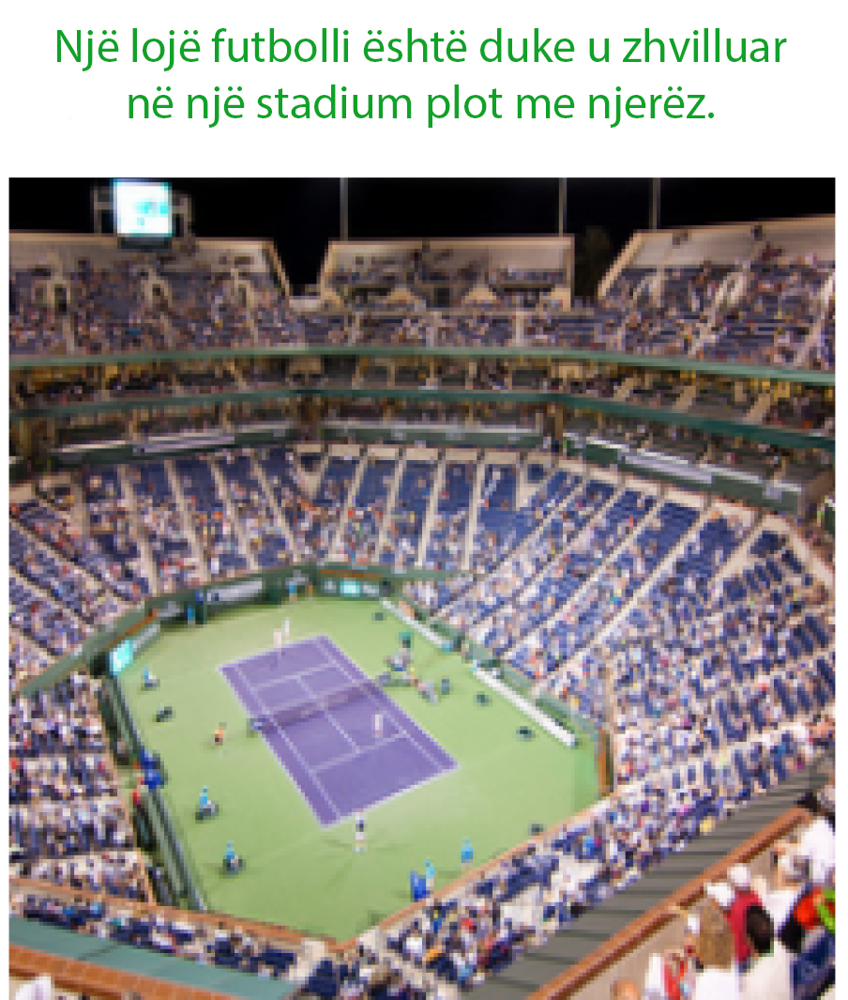

# ICG-API: Image captions in the Albanian language

[](https://github.com/dhimitriosduka1/icg-api/actions/workflows/ci.yml)

ICG-API is a small HTTP API around a model that generates image captions in the Albanian language.
The model leverages an existing dataset with English captions and employs a pretrained Neural Machine
Translation model to automatically translate the captions to Albanian. It makes use of an existing
Encoder-Decoder architecture and transfer learning to leverage pretrained image features in the Encoder
part of the architecture to both reduce computational complexity and to increase the generalizability
of the approach. The results **(BLEU-4 score of 12.6)** are close to those of works using similar architectures
for English captions and show that Albanian is a more complex language compared to English.

## Samples

<p align="center">
  
  
</p>

<p align="center">
  
  
</p>

## Quickstart

The model weights (`artifacts/model.pth.tar`, ~765 MB) are stored with [Git LFS](https://git-lfs.com).
Fetch them after cloning:

```bash
git lfs install
git lfs pull
```

### With Docker

```bash
docker build -t icg-api .
docker run --rm -p 3000:3000 icg-api
```

### Locally

Requires [uv](https://docs.astral.sh/uv/).

```bash
uv sync
uv run icg-api
```

The API listens on <http://localhost:3000>. Interactive documentation is at
<http://localhost:3000/docs>.

## API

### `POST /predict`

Upload an image as the multipart form field `image`:

```bash
curl -F image=@samples/best_2.png http://localhost:3000/predict
```

```json
{"caption": "Një burrë me këmishë të zezë dhe një burrë me këmishë të zezë po luajnë me kitarë."}
```

From Python:

```python
import httpx

with open("photo.jpg", "rb") as image:
    response = httpx.post("http://localhost:3000/predict", files={"image": image})
print(response.json()["caption"])
```

| Status | Meaning                                          |
|--------|--------------------------------------------------|
| 200    | Caption generated                                |
| 400    | The upload is not a readable image               |
| 413    | The upload is larger than `ICG_MAX_UPLOAD_BYTES` |
| 422    | The `image` form field is missing                |

### `GET /health`

Returns `{"status": "ok"}` once the model is loaded. The Docker image uses it as its health check.

## Configuration

Settings are read from environment variables:

| Variable                 | Default                   | Description                                    |
|--------------------------|---------------------------|------------------------------------------------|
| `ICG_CHECKPOINT_PATH`    | `artifacts/model.pth.tar` | Model weights                                  |
| `ICG_VOCABULARY_PATH`    | `artifacts/vocab.json`    | Token list matching the weights                |
| `ICG_DEVICE`             | `auto`                    | `auto` (CUDA if available), `cpu`, `cuda`, ... |
| `ICG_MAX_CAPTION_LENGTH` | `20`                      | Maximum number of generated tokens             |
| `ICG_MAX_UPLOAD_BYTES`   | `10485760` (10 MiB)       | Largest accepted upload                        |
| `ICG_HOST`               | `0.0.0.0`                 | Bind address                                   |
| `ICG_PORT`               | `3000`                    | Port                                           |
| `ICG_LOG_LEVEL`          | `info`                    | `debug`, `info`, `warning` or `error`          |

On Linux, the CPU-only PyTorch build is installed to keep the Docker image small. To use a GPU,
remove the `[tool.uv.sources]` entries from `pyproject.toml` and run `uv lock`.

To serve with several worker processes, use uvicorn's factory mode:

```bash
uv run uvicorn icg_api.app:create_app --factory --host 0.0.0.0 --port 3000 --workers 4
```

## Model

| Component  | Details                                                                     |
|------------|-----------------------------------------------------------------------------|
| Encoder    | ResNet-101 pretrained on ImageNet, partially fine-tuned, projected to 1024-d |
| Decoder    | 2-layer LSTM, 1024-d embeddings and hidden state, greedy decoding           |
| Vocabulary | 10,078 tokens: words that appear at least 5 times in the corpus             |
| Data       | Flickr30k captions (158,915) machine-translated to Albanian                 |
| Input      | Resized to 356×356, center-cropped to 224×224, ImageNet normalization       |
| Training   | Adam, learning rate 1e-4 (decayed during training), batch size 128          |

`artifacts/vocab.json` is generated from `corpus/annotations.csv`. Its order must match the one
used in training, so only rebuild it when retraining:

```bash
uv run scripts/build_vocab.py
```

## Project layout

```
src/icg_api/
├── app.py          # FastAPI app and routes
├── captioner.py    # Loads the weights; preprocesses images and generates captions
├── model.py        # ResNet-101 encoder and LSTM decoder
├── vocabulary.py   # Tokenization and the token <-> index mapping
├── settings.py     # ICG_* environment variables
└── __main__.py     # `icg-api` command
artifacts/          # Model weights (Git LFS) and vocabulary
corpus/             # Albanian caption corpus
scripts/            # Maintenance scripts
tests/
```

## Development

```bash
uv sync
uv run pytest            # The real-model test runs only when the LFS weights are present
uv run ruff check .
uv run ruff format .
```

## License

[MIT](LICENCE)
